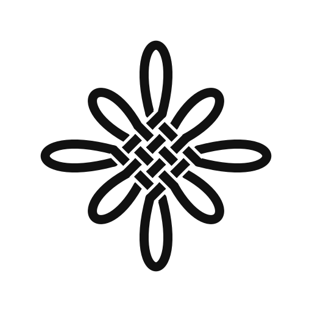

<p align="center">
  <picture>
    <source media="(prefers-color-scheme: dark)" srcset="docs/media/loom-mark-dark.svg">
    
  </picture>
</p>

<h1 align="center">Loom</h1>

<p align="center">
  <b>Your agent doesn't stop when you do.</b><br>
  Claude Code and Codex on your server, from any browser.
</p>

<p align="center">
  <a href="LICENSE"></a>
  
  
</p>

https://github.com/user-attachments/assets/98ce22ab-07c6-4d59-a75f-6b84845c73d3

A single-user, self-hosted front end for coding agents. Sessions live on your
server, not in a tab:

- **Close the lid.** The turn keeps running; a push notification says when it's done.
- **Same session, any device.** Pick it up on your phone on the train, or back at your desk; each tab replays only what it missed.
- **Take over its browser.** The agent's Chromium is yours when it hits a login or a captcha.
- **Your own machines, too.** Agents run commands and move files on your Mac, Linux box or WSL.
- **Then make it an app.** Repeated work becomes a plain program on a schedule: no model needed to use it.

Under the hood: Elixir / Phoenix, one GenServer per session and per PTY,
streamed over Phoenix Channels, state on disk under `~/.loom`. The frontend is
Vite + React + xterm.js in `frontend/`. The `claude` and `codex` CLIs do the
work; Loom makes no model requests of its own.

## What it does

**Sessions**
- Claude Code or Codex, chosen per session and fixed for its life.
- Every device sees the same session; a reconnecting tab replays only what it
  missed. A message sent mid-turn joins the running turn.
- Attachments (images scaled to 2000 px in the browser, EXIF kept). The
  composer keeps a draft per session.
- `/compact`, `/reload` (new CC / Codex config, no restart), `/cron`.
- Directories, one level deep, in the sidebar; search over titles and over
  what was said (ripgrep). A deleted session goes to a trash on disk.

**Canvas.** Whatever an agent writes to the session's `output/` opens beside
the chat: pages, charts, images, video, PDF, Markdown, tables. A file tree
lists every upload and output of the session. Pages run sandboxed on an opaque
origin. Slides are reveal.js decks served by Loom itself, with a PDF button.

**Terminals.** Real PTYs beside the chat. They outlive the tab, can be shared
by two devices, and pass OSC 52 clipboard writes to the browser.

**Apps.** Repeated work an agent distills into a plain program, so using it
needs no model: a page or a whole site, optionally a server and a scheduled
job. Loom only registers them: systemd runs them (socket-activated, idle exit,
timers) and Caddy serves them on an origin of their own, so they stay up
while Loom restarts. They open beside the chat from an Apps grid in the
sidebar; any login is the app's own.

**Scheduled prompts.** Cron jobs that submit a prompt to a session; agents
make them, `/cron` lists them.

**Your devices (loom-node).** A small Go daemon on a Mac, Linux box or WSL
dials out to Loom, so agents can run commands and read and write files there.
One-line install from the Devices dialog; a token per device, kept as a hash.

**Browser.** An optional Chromium on a virtual display that agents drive over
CDP, logged in where you signed in once. You take it over from the sidebar
(noVNC) for logins and captchas.

**App shell.** Installable PWA; Web Push when a turn ends (no account, Loom
signs them); light and dark themes; built for phones; optional Vim-style keys
([docs/keys.md](docs/keys.md)). `rel/deploy.sh` deploys Loom from inside Loom
and restarts once every session is idle.

Agent instructions ship as skills in `skills/` (apps, browser, cron, sessions,
slides) and `node/SKILL.md`, copied to both backends on deploy.

## Docs

- [docs/architecture.md](docs/architecture.md): how Loom is built
- [docs/backends.md](docs/backends.md): the Claude Code and Codex protocols, as measured
- [docs/deploy.md](docs/deploy.md): EC2 + Cloudflare Tunnel + systemd
- [docs/keys.md](docs/keys.md): the keyboard

## Requirements

- Elixir / Erlang (see `mix.exs`), Node.js + pnpm, Go (for `loom-node`)
- `claude` and `codex` on `PATH`, both logged in
- Optional: `rg` for search; Caddy and systemd user units for apps

## Development

```sh
mix setup && (cd frontend && pnpm install)

mix phx.server             # backend on :4000
cd frontend && pnpm dev    # frontend on :5173, proxies /api and /socket
```

Open http://localhost:5173. The password is `LOOM_PASSWORD` (`loom` in dev).

| Command | |
| --- | --- |
| `mix test` | Backend tests |
| `mix precommit` | Compile with warnings as errors, format, test |
| `cd frontend && pnpm build` | Type-check and build |
| `cd frontend && pnpm md:check` | Markdown renderer cases |
| `cd frontend && pnpm transcript …` | Record / replay a live agent stream ([details](docs/architecture.md#91-debugging-record-and-replay)) |

## License

[MIT](LICENSE). Demo video by [@ensean](https://github.com/ensean).
