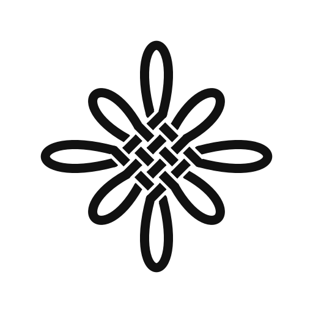

<p align="center">
  <picture>
    <source media="(prefers-color-scheme: dark)" srcset="docs/media/loom-mark-dark.svg">
    
  </picture>
</p>

<h1 align="center">Loom</h1>

<p align="center">
  <b>Your agent doesn't stop when you do.</b><br>
  Claude Code, Codex and Kiro on your server, from any browser.
</p>

<p align="center">
  <a href="LICENSE"></a>
  
  
</p>

https://github.com/user-attachments/assets/98ce22ab-07c6-4d59-a75f-6b84845c73d3

A single-user, self-hosted front end for coding agents. Sessions live on your
server, not in a tab:

- **Close the lid.** The turn keeps running; a push notification says when it's done.
- **Same session, any device.** Pick it up on your phone on the train, or back at your desk; each tab replays only what it missed.
- **Take over its browser.** The agent's Chromium is yours when it hits a login or a captcha.
- **Your own machines, too.** Agents run commands and move files on your Mac, Linux box or WSL.
- **Then make it an app.** Repeated work becomes a plain program on a schedule: no model needed to use it.

Under the hood: Elixir / Phoenix, one GenServer per session and per PTY,
streamed over Phoenix Channels, state on disk under `~/.loom`. The frontend is
Vite + React + xterm.js in `frontend/`. The `claude`, `codex` and `kiro-cli`
CLIs do the work; Loom makes no model requests of its own.

## What it does

**Sessions**
- Claude Code, Codex or Kiro, chosen per session and fixed for its life.
- Every device sees the same session; a reconnecting tab replays only what it
  missed. A message sent mid-turn joins the running turn.
- Attachments (images scaled to 2000 px in the browser, EXIF kept). The
  composer keeps a draft per session.
- `/compact`, `/reload` (new CC / Codex / Kiro config, no restart), `/cron`.
- Groups, one level deep, in the sidebar; search over titles and over what
  was said (ripgrep). A deleted session goes to a trash on disk.

**Canvas.** Whatever an agent writes to the session's `output/` opens beside
the chat: pages, charts, images, video, PDF, Markdown, tables. A file tree
lists every upload and output of the session. Pages run sandboxed on an opaque
origin. Slides are reveal.js decks served by Loom itself, with a PDF button.

**Terminals.** Real PTYs beside the chat. They outlive the tab, can be shared
by two devices, and pass OSC 52 clipboard writes to the browser. The
terminal column's `+` opens a shell on the server or on an online device.

**Apps.** Repeated work an agent distills into a plain program, so using it
needs no model: a page or a whole site, optionally a server and a scheduled
job. Loom only registers them: systemd runs them (socket-activated, idle exit,
timers) and Caddy serves them on an origin of their own, so they stay up
while Loom restarts. They open beside the chat from an Apps grid in the
sidebar; any login is the app's own.

**Scheduled prompts.** Cron jobs that submit a prompt to a session; agents
make them, `/cron` lists them.

**Your devices (loom-node).** A small Go daemon on a Mac, Linux box or WSL
dials out to Loom, so agents can run commands and read and write files there,
and you can open terminals on it. One-line install from the Devices dialog
(foot of the sidebar); a token per device, kept as a hash. One device can
serve several Looms.

**Connect.** A Mac's own screen, from the Devices dialog (macOS devices only).
H.264 from [loom-mac-screen](https://github.com/EthanLLL/loom-mac-screen) on
the Mac's `127.0.0.1:5960`, or macOS Screen Sharing over VNC (5900) when that
is not running. WebRTC goes direct when the two networks allow it (hole
punching, STUN only, no TURN); otherwise Loom relays it.

**Browser.** An optional Chromium on a virtual display that agents drive over
CDP. Started on first use, stopped after 10 idle minutes; logins persist. You
take it over from the sidebar (noVNC) for logins and captchas.

**Sign-in.** A passkey, or the password; once an authenticator is set up, the
password needs its code or one of the recovery codes. One login per device,
listed in Settings and revocable. Five wrong passwords or codes within 15
minutes shut the password way in for the rest of that window.

**App shell.** Installable PWA; Web Push when a turn ends (no account, Loom
signs them); light and dark themes; built for phones. `rel/deploy.sh` deploys
Loom from inside Loom and restarts once every session is idle.

Agent instructions ship as skills in `skills/` (apps, browser, cron, profiles,
sessions, slides) and `node/SKILL.md` (as `loom-nodes`, when Go is present),
copied on deploy to `~/.claude/skills`, `~/.codex/skills` and
`~/.kiro/skills`.

## Docs

- [docs/architecture.md](docs/architecture.md): how Loom is built
- [docs/backends.md](docs/backends.md): the Claude Code, Codex and Kiro (ACP) protocols, as measured
- [docs/deploy.md](docs/deploy.md): running it on a server: toolchain, `.env`, build, systemd, apps, browser, devices, updates

## Requirements

- Elixir `~> 1.17` with Erlang/OTP; Node.js (built with 24) and pnpm
- Go 1.27.2 or newer, only for the `loom-node` device binaries
- `claude`, `codex` and/or `kiro-cli` on `PATH`, logged in (only the ones you use)
- Optional: `rg` for search; Caddy and systemd user units for apps

## Development

```sh
mix setup                  # deps.get and the frontend's pnpm install

mix phx.server             # backend on :4000
cd frontend && pnpm dev    # frontend on :5173, proxies /api, /socket and the other backend paths
```

Open http://localhost:5173. The password is `LOOM_PASSWORD` (`loom` in dev).

| Command | |
| --- | --- |
| `mix test` | Backend tests |
| `mix precommit` | Compile with warnings as errors, format, test |
| `cd frontend && pnpm build` | Type-check and build |
| `cd frontend && pnpm lint` | Lint (oxlint) |
| `cd frontend && pnpm md:check` | Markdown renderer cases |
| `cd frontend && pnpm transcript …` | Record / replay a live agent stream (see `frontend/tools/transcript.mjs`) |
| `make -C node test` | loom-node tests |

## Contributors

<a href="https://github.com/EthanLLL/loom/graphs/contributors">
  
</a>

Demo video by [@ensean](https://github.com/ensean).

## Built with Claude Code, inside Loom

Loom is written by [Claude Code](https://claude.com/claude-code) running in a
Loom session: nearly every commit is co-authored by Claude, and each new
version is deployed from inside the Loom it replaces (`rel/deploy.sh`).

## Thanks, Elixir and Phoenix

I had pictured Loom for a long time, because on the BEAM its shape is simple:
a process per session, PubSub to every device, a supervisor for whatever
crashes. [Elixir](https://elixir-lang.org) and
[Phoenix](https://www.phoenixframework.org) made it a design worth building;
Claude Code made the first version a week's work. Thank you to José Valim and
everyone behind them.

## License

[MIT](LICENSE)
